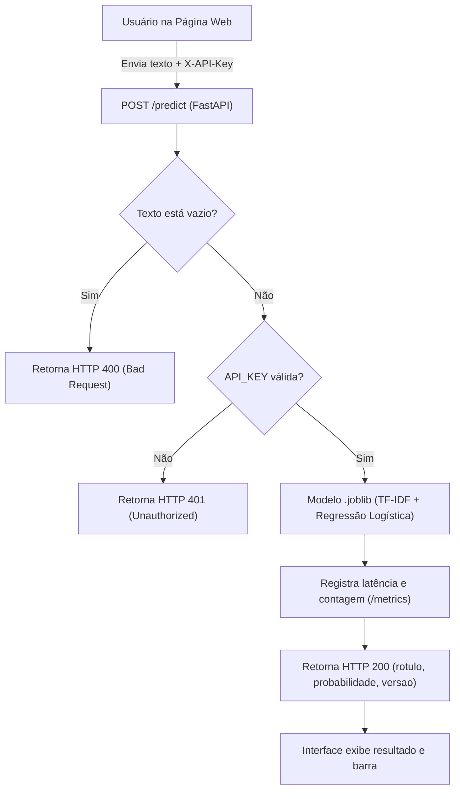
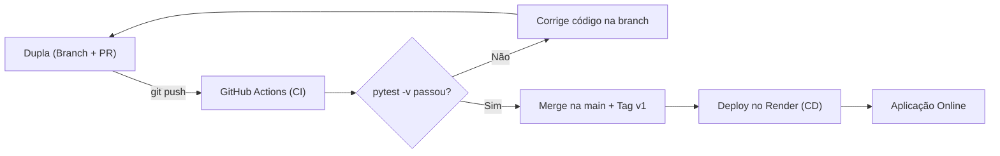

# 🛡️ Classificador de Spam — Do Notebook à Produção (Etapa 1)

> **Componente Curricular:** MLOps e Deploy  
> **Dupla:** Rafaela & Francisco  
> **Repositório:** [https://github.com/DK7E3/mlops-spam-Rafaela-Francisco](https://github.com/DK7E3/mlops-spam-Rafaela-Francisco)  
> **Versão de Entrega:** `v1`  
> **URL da Aplicação Online (Render):** <https://mlops-spam-rafaela-francisco.onrender.com> *(Ativa e Operacional)*
---

## 1. Visão Geral do Projeto

Este projeto implementa a infraestrutura de entrega e operação em produção (MLOps) para um modelo de classificação de mensagens de texto em **spam** ou **não spam**. 

O modelo pré-treinado (`model/modelo.joblib`), baseado em **TF-IDF + Regressão Logística**, foi desacoplado do ambiente exploratório (notebooks) e integrado a uma **API REST de alta performance** com interface visual interativa e painel de métricas operacionais em tempo real.

### Fluxograma de Inferência (`POST /predict`)



### Fluxograma da Esteira MLOps (Git → CI → Deploy)



---

## 2. Tecnologias Escolhidas e Justificativas Técnicas

| Componente | Tecnologia | Justificativa Técnica |
|---|---|---|
| **Linguagem** | Python 3.12 | Padrão da indústria para Ciência de Dados e MLOps, oferecendo ampla compatibilidade e ótimo desempenho de I/O assíncrono. |
| **Framework API** | **FastAPI** (`0.115.6`) | Escolhido pela alta performance com ASGI (`async`), validação de dados automática e estrita via Pydantic, geração nativa de documentação Swagger (`/docs`) e baixo overhead. |
| **Servidor ASGI** | **Uvicorn** (`0.34.0`) | Servidor rápido e padrão de mercado para execução de aplicações FastAPI. |
| **Machine Learning** | **scikit-learn** (`1.8.0`) + **Joblib** (`1.6.0`) | Versão obrigatória e exata para carregamento íntegro do artefato serializado `modelo.joblib`, evitando incompatibilidades de desserialização (`InconsistentVersionWarning`). |
| **Interface Web** | HTML5, CSS3 Moderno e Vanilla JavaScript | Desenvolvido sem frameworks pesados (Node.js/React/Vue), garantindo carregamento instantâneo, zero dependências externas extras e execução leve acoplada ao próprio FastAPI (`StaticFiles`). |
| **Containerização** | **Docker** (`python:3.12-slim`) | Garante reprodutibilidade entre ambientes, cache otimizado de camadas e isolamento de segredos via `.dockerignore`. |
| **Orquestração Local** | **Kubernetes** (`Docker Desktop / kubeadm`) | Gerencia réplicas (`Deployment`), sondas de saúde e prontidão (`livenessProbe` e `readinessProbe` em `/health`), injeção de segredos (`Secret`) e balanceamento (`Service`). |
| **Observabilidade & Logs** | **Python Logging** | Logs estruturados padronizados (`INFO` para inferências bem-sucedidas e carregamento de modelo, `WARNING` para erros 400 e acessos 401 não autorizados). |
| **Hospedagem / Deploy** | **Render** | Permite deploy contínuo direto do GitHub, integração nativa de variáveis de ambiente seguras e plano gratuito estável. |

---

## 3. Contrato da API

### `GET /health`
Verifica a disponibilidade da aplicação (*liveness probe*). **Não exige chave de API.**
* **Código HTTP:** `200 OK`
* **Exemplo de Resposta:**
  ```json
  {
    "status": "ok",
    "versao": "v1",
    "ambiente": "dev"
  }
  ```

### `POST /predict`
Realiza a inferência da mensagem.
* **Autenticação:** Se a variável `API_KEY` estiver configurada no servidor, exige o cabeçalho `X-API-Key`.
* **Corpo da Requisição (Payload):**
  ```json
  {
    "texto": "Parabéns! Você ganhou um prêmio, clique no link para resgatar agora"
  }
  ```
* **Códigos de Resposta:**
  * `200 OK`: Classificação realizada com sucesso.
    ```json
    {
      "rotulo": "spam",
      "probabilidade": 0.67,
      "versao": "v1"
    }
    ```
  * `400 Bad Request`: Mensagem vazia ou apenas com espaços em branco.
  * `401 Unauthorized`: Cabeçalho `X-API-Key` ausente ou incorreto.

### `GET /metrics`
Endpoint de telemetria para o painel de operação em tempo real.
* **Exemplo de Resposta:**
  ```json
  {
    "requisicoes": 128,
    "erros_5xx": 0,
    "latencia_media_ms": 14.2
  }
  ```

---

## 4. Variáveis de Ambiente e Configurações

Seguindo os princípios do **12-Factor App**, nenhuma configuração sensível ou de ambiente é gravada de forma fixa no código-fonte.

As variáveis devem ser configuradas via arquivo `.env` (no ambiente local) ou no painel da plataforma de deploy:

| Variável | Descrição | Exemplo Local (`dev`) | Exemplo Produção (`prod`) |
|---|---|---|---|
| `APP_ENV` | Define o ambiente em que a aplicação está executando | `dev` | `prod` ou `test` |
| `MODEL_VERSION` | Versão ativa do modelo de ML para rastreabilidade | `v1` | `v1` |
| `API_KEY` | Chave secreta exigida para autorizar o `/predict` | `chave-ficticia-123` | *(definida no Render)* |
| `MODEL_PATH` | *(Opcional)* Caminho para o arquivo `.joblib` | `model/modelo.joblib` | `model/modelo.joblib` |

> ⚠️ **Segurança:** O arquivo `.env` está explicitamente ignorado no `.gitignore` para garantir que nenhum segredo seja enviado ao repositório público.

### Diferença entre `APP_ENV=dev` e `APP_ENV=test` / `prod`

* **`APP_ENV=dev` (ambiente local):** utilizado nas máquinas da dupla durante o desenvolvimento. As variáveis são lidas do arquivo `.env` local (ignorado pelo Git), o servidor roda com `--reload` automático e os testes são feitos em `localhost:8000`.
* **`APP_ENV=test` ou `prod` (ambiente online / CI):** utilizado no GitHub Actions (`test`) e na plataforma de hospedagem Render (`test`/`prod`). Não existe arquivo `.env` no repositório; todas as variáveis e segredos (`API_KEY`, `MODEL_VERSION`, `APP_ENV`) são injetados diretamente pelo painel da plataforma e o servidor executa em modo de produção sem `--reload`, exposto em `0.0.0.0:$PORT`.

---

## 5. Como Executar Localmente Passo a Passo

### 5.1 Pré-requisitos
* **Python:** Versão 3.10, 3.11 ou 3.12 instalada.
* **Git** instalado.

### 5.2 Passo a Passo

1. **Clonar o Repositório:**
   ```bash
   git clone https://github.com/DK7E3/mlops-spam-Rafaela-Francisco.git
   cd mlops-spam-Rafaela-Francisco
   ```

2. **Criar e Ativar o Ambiente Virtual:**
   * No Linux / macOS:
     ```bash
     python3 -m venv .venv
     source .venv/bin/activate
     ```
   * No Windows (PowerShell):
     ```powershell
     python -m venv .venv
     .venv\Scripts\Activate.ps1
     ```

3. **Instalar as Dependências:**
   ```bash
   pip install -r requirements.txt
   ```

4. **Configurar as Variáveis de Ambiente:**
   Copie o modelo de exemplo para criar seu arquivo `.env`:
   * No Linux / macOS: `cp .env.example .env`
   * No Windows: `copy .env.example .env`

5. **Iniciar a Aplicação:**
   ```bash
   uvicorn app.main:app --reload
   ```

6. **Acessar a Aplicação:**
   * **Interface Web:** [http://localhost:8000](http://localhost:8000)
   * **Documentação Interativa Swagger:** [http://localhost:8000/docs](http://localhost:8000/docs)
   * **Healthcheck:** [http://localhost:8000/health](http://localhost:8000/health)

### 5.3 Executar via Docker (Container)

1. **Construir a imagem:**
   ```bash
   docker build -t spam-api:v1 .
   ```
2. **Iniciar o container (injetando o `.env` sem embutir segredos na imagem):**
   ```bash
   docker run -d -p 8000:8000 --env-file .env --name classificador spam-api:v1
   ```
3. **Inspecionar logs e parar o container:**
   ```bash
   docker logs classificador
   docker stop classificador && docker rm classificador
   ```

### 5.4 Executar no Cluster Kubernetes Local (`kubectl`)

Com o Kubernetes ativado no Docker Desktop (`context: docker-desktop`) e a imagem `spam-api:v1` construída localmente:

1. **Criar o Secret do Kubernetes a partir do seu `.env` local (mantém a `API_KEY` fora do Git):**
   ```bash
   kubectl create secret generic spam-api-env --from-env-file=.env
   ```
2. **Aplicar o manifesto (`Deployment` com 2 réplicas + `livenessProbe` em `/health` + `Service`):**
   ```bash
   kubectl apply -f k8s/deployment.yaml
   kubectl get pods
   kubectl get svc
   ```
3. **Expor o serviço localmente via `port-forward`:**
   ```bash
   kubectl port-forward svc/spam-api 8080:8000
   ```
   Acesse em: [http://localhost:8080](http://localhost:8080)
4. **Comandos úteis de operação no cluster (escala e rollback):**
   ```bash
   kubectl scale deployment spam-api --replicas=3
   kubectl rollout undo deployment/spam-api
   ```

---

## 6. Exemplos de Teste via Terminal (`curl`)

### Teste de Healthcheck:
```bash
curl -X GET http://localhost:8000/health
```

### Teste de Classificação com Chave Correta:
```bash
curl -X POST http://localhost:8000/predict \
  -H "Content-Type: application/json" \
  -H "X-API-Key: chave-ficticia-123" \
  -d "{\"texto\": \"Você ganhou um prêmio exclusivo! Clique aqui para resgatar\"}"
```

### Teste de Rejeição de Chave Inválida (HTTP 401):
```bash
curl -i -X POST http://localhost:8000/predict \
  -H "Content-Type: application/json" \
  -H "X-API-Key: chave-incorreta" \
  -d "{\"texto\": \"Olá, tudo bem?\"}"
```

### Teste de Rejeição de Mensagem Vazia (HTTP 400):
```bash
curl -i -X POST http://localhost:8000/predict \
  -H "Content-Type: application/json" \
  -H "X-API-Key: chave-ficticia-123" \
  -d "{\"texto\": \"   \"}"
```

---

## 7. Testes Automatizados e Pipeline de CI/CD

O projeto possui **9 testes automatizados** divididos em `tests/test_api.py` (testes funcionais: `/health`, `/ready`, `/metrics`, predição `spam` e `nao_spam`, interface web `GET /`) e `tests/test_security.py` (testes de segurança e validação: erros `401` e `400`).

### Rodar os testes e o linter localmente
```bash
pip install pytest httpx ruff
ruff check app/ tests/
pytest -v
```

### Integração e Entrega Contínua (GitHub Actions — 4 Etapas)
O workflow definido em `.github/workflows/ci.yml` executa automaticamente 4 etapas encadeadas:
1. **1. Build e Lint (Ruff):** valida sintaxe e padronização do código Python.
2. **2. Testes Automatizados (Pytest):** executa `tests/test_api.py` e `tests/test_security.py`.
3. **3. Empacotar e Publicar Imagem Docker (GHCR):** constrói a imagem Docker e publica no *GitHub Container Registry* (`ghcr.io`).
4. **4. Deploy em Ambiente de Teste:** aciona o *Deploy Hook* do Render apenas se todas as etapas anteriores passarem na branch `main`.

---

## 8. Observabilidade, Probes e Automação de Operações (Etapa 4)

* **Logs Estruturados em JSON (`stdout`):** cada evento da API é emitido como uma linha JSON na saída padrão (`hora`, `nivel`, `mensagem`, `versao`, `id`, `rota`, `status`, `ms`), incluindo um identificador único por requisição (`X-Request-ID`) e **sem jamais registrar chaves de API ou o texto das mensagens dos usuários**.
  ```json
  {"hora": "20:15:03", "nivel": "INFO", "mensagem": "requisição atendida", "versao": "v1", "id": "a1b2c3d4", "rota": "/predict", "status": 200, "ms": 2.1, "rotulo": "spam", "probabilidade": 0.67}
  ```
* **Probes e Recursos no Kubernetes (`k8s/deployment.yaml`):**
  * `livenessProbe` em `GET /health` e `readinessProbe` em `GET /ready`.
  * Estratégia `RollingUpdate` (`maxUnavailable: 0`, `maxSurge: 1`) e limites de recursos (`requests: 100m CPU / 128Mi RAM`, `limits: 256Mi RAM`).
* **Script de Verificação, Alertas e Auto-Recuperação (`scripts/verificar_saude.py`):**
  * Monitora `/health` e `/metrics` a cada 10 segundos, emitindo alertas em JSON se a latência média ultrapassar `500 ms`, se `erros_5xx > 5` ou se o serviço cair (acionando `kubectl rollout restart deployment/spam-api` após 3 falhas seguidas):
    ```bash
    python scripts/verificar_saude.py --once
    python scripts/verificar_saude.py
    ```
* **CronJob no Cluster (`k8s/cronjob.yaml`):**
  * Tarefa recorrente agendada a cada 5 minutos (`*/5 * * * *`) para verificar `http://spam-api:8000/health` internamente no cluster:
    ```bash
    kubectl apply -f k8s/cronjob.yaml
    kubectl get cronjobs
    ```

---

## 9. Divisão de Responsabilidades da Dupla

O desenvolvimento foi conduzido em regime de **Pair Programming** (piloto e copiloto), com alternância de tarefas:

* **Francisco:**
  * Configuração inicial do ambiente virtual e dependências exatas (`scikit-learn==1.8.0`).
  * Implementação da arquitetura base do FastAPI e carregamento do modelo em memória.
  * Construção e estilização da interface web (`index.html`) com tema Dark Mode.
  * Criação do coletor de métricas e gerador de carga (50 requisições).
  * Containerização com Dockerfile e manifesto base do Kubernetes.
  * Configuração do workflow de CI/CD para deploy no Render via Webhook.

* **Rafaela:**
  * Implementação da lógica de autenticação por cabeçalho `X-API-Key` e validações de erro (HTTP 401 e 400).
  * Implementação da observabilidade com logs estruturados (`logging`) na API (`INFO` e `WARNING`).
  * Configuração e inclusão da sonda de prontidão (`readinessProbe`) no manifesto Kubernetes para evitar tráfego antes do carregamento do modelo.
  * Elaboração e expansão da suíte de 8 testes automatizados unitários e de integração (`tests/test_api.py`), cobrindo `nao_spam` e rota estática raiz (`GET /`).
  * Configuração da política de CORS para garantir integridade das chamadas da interface.
  * Estruturação e redação da documentação técnica no `README.md` e fechamento da versão `v1`.
